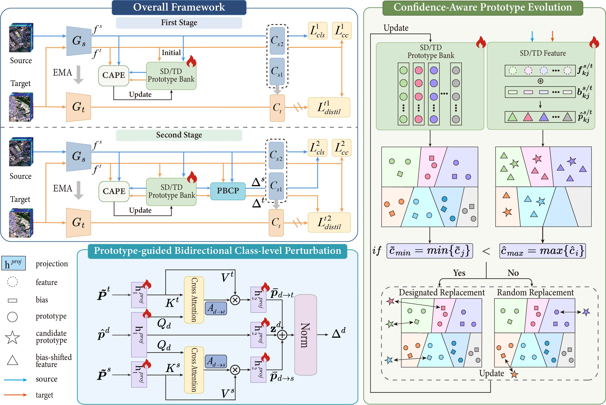

# PGMCP

This repository provides the implementation for the paper **"Prototype Evolution-Guided Mutual Class-Level Perturbation for Cross-Scene Hyperspectral Image Classification"**.

## Abstract

Unsupervised domain adaptation (UDA) has been widely applied to cross-scene hyperspectral image (HSI) classification for reliable knowledge transfer. Recently, self-training-based UDA methods have achieved promising performance with consistency learning. However, the random or globally shared variations used for consistency learning lack class-level semantic guidance, limiting their ability to model heterogeneous class-dependent domain shifts.

To address this limitation, we propose a **Prototype Evolution-Guided Mutual Class-Level Perturbation (PGMCP)** framework for cross-scene HSI classification. Built upon a teacher–student self-training framework, PGMCP introduces prototype evolution-guided class-level perturbation to explicitly model class-dependent cross-domain variations. Specifically, PGMCP follows a two-stage training strategy. In the first stage, a **Confidence-Aware Prototype Evolution (CAPE)** module progressively constructs and refines reliable source and target domain prototype banks as semantic anchors. In the second stage, a **Prototype-Guided Bidirectional Class-Level Perturbation (PBCP)** module leverages these evolved prototypes to generate semantically guided perturbations for both domains, while prototype evolution continues. This sequential process enables reliable prototype guidance for modeling heterogeneous class-dependent domain shifts while preserving semantic consistency.

Experiments on four benchmark datasets demonstrate the effectiveness of PGMCP compared with representative state-of-the-art methods.

## Overview


## Overview



## Requirements

The experiments described in the paper were implemented using **PyTorch** on an **NVIDIA RTX 4090 GPU with CUDA 11.8**.

## Datasets

Please prepare the corresponding hyperspectral images and ground-truth labels before running the experiments.

The example layout below is **illustrative**; adjust the directory names and filenames to match your data loader and the actual dataset files:

```text
data/
├── Houston/
│   ├── <Houston-2013 source data and labels>
│   └── <Houston-2018 target data and labels>
├── NC/
│   ├── <NC12 source data and labels>
│   └── <NC13 target data and labels>
├── HyRANK/
│   ├── <Dioni source data and labels>
│   └── <Loukia target data and labels>
└── S-H/
    ├── <Shanghai source data and labels>
    └── <Hangzhou target data and labels>
```

> Dataset download URLs are not specified in the paper. Add verified download links and the exact expected `.mat` filenames when the repository is prepared.

## Usage

To reproduce the PGMCP experiments:

1. Clone or download this repository and configure the PyTorch environment.
2. Download the required HSI datasets and place them in the directories expected by the data-loading code.
3. Select a source–target transfer task (Houston 2013 → Houston 2018, NC12 → NC13, Dioni → Loukia, or Shanghai → Hangzhou).
4. Run the corresponding training script. PGMCP first performs prototype evolution in Stage I and then activates bidirectional class-level perturbation in Stage II.
5. Evaluate target-domain predictions using **Overall Accuracy (OA)**, **Average Accuracy (AA)**, and the **Kappa coefficient**.

> **Note:** The exact training and evaluation commands are not provided in the manuscript. Replace this section with verified commands after the codebase and its entry-point scripts are finalized.

## Citation

If you find this work useful, please consider citing our paper:

Qin Xu, Meng Zhang, Zhicheng Zhao, Yuxuan Zhang, Bo Jiang, Jin Tang, and Bin Luo. **"Prototype Evolution-Guided Mutual Class-Level Perturbation for Cross-Scene Hyperspectral Image Classification."** Preprint submitted to Elsevier.

```bibtex
@misc{xu_pgmcp,
  author = {Xu, Qin and Zhang, Meng and Zhao, Zhicheng and Zhang, Yuxuan and Jiang, Bo and Tang, Jin and Luo, Bin},
  title = {Prototype Evolution-Guided Mutual Class-Level Perturbation for Cross-Scene Hyperspectral Image Classification},
  note = {Preprint submitted to Elsevier}
}
```

> The uploaded manuscript does not specify a final publication year, volume, pages, or DOI. Please update the citation when the official bibliographic details become available.
